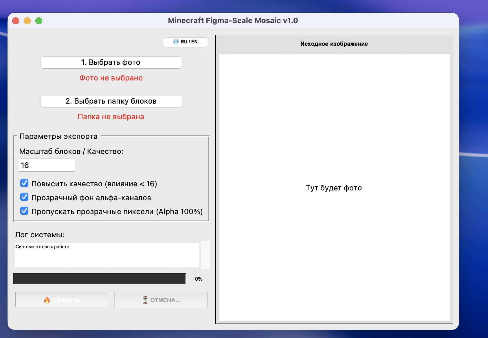
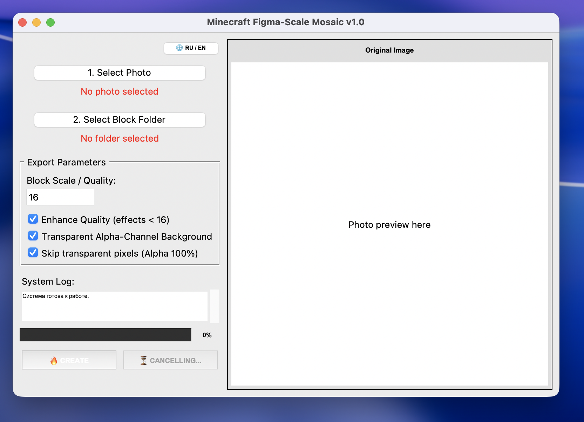

# 🗺️ Minecraft Figma-Scale Mosaic Maker (v1.0)

[English](#english) | [Русский](#русский)

---

## <a name="русский">🇷🇺 Русский</a>

Десктопное приложение, разработанное эксклюзивно для macOS, для автоматического преобразования любых изображений и Figma-артов в детализированную мозаику из блоков игры **Minecraft**.

Программа анализирует текстуры блоков, вычисляет их точный средний цвет (с умным учетом прозрачности альфа-каналов) и собирает финальный детализированный арт.

### ✨ Основные возможности

*   **🔥 Figma Ultra-Upscale:** Умное масштабирование текстур и качественный апскейл для маленьких Figma-иконок и пиксель-артов без размытия (алгоритм `NEAREST`).
*   **💎 Точный математический подбор:** Расчёт среднеквадратичного отклонения цвета блоков по RGB матрицам, исключая прозрачные зоны пикселей.
*   **👻 Пропуск прозрачности (Alpha 100%):** Специальная опция, позволяющая полностью игнорировать пустые зоны на PNG-картинках, чтобы программа не заставляла их лишними блоками.
*   **🛑 Безопасная многопоточность:** Процесс сборки вынесен в отдельный поток — интерфейс программы не зависает, а прогресс-бар плавно отображает статус. Сборку можно мгновенно прервать кнопкой «Отмена».

### 📥 Скачать готовую программу

Если у вас не установлен Python, вы можете скачать готовую автономную версию программы для macOS по кнопке ниже:

[

> ⚠️ **Примечание для запуска:** Так как приложение собрано вручную, система защиты Gatekeeper заблокирует первый запуск. Чтобы запустить его, нажмите на файл `.app` правой кнопкой мыши, выберите **Открыть**, а затем во всплывающем окне подтвердите запуск кнопкой **«Открыть»**.

### 📸 Интерфейс программы

---

## <a name="english">🇺🇸 English</a>

A desktop application designed exclusively for macOS to automatically convert any images and Figma artworks into highly detailed mosaics made of **Minecraft** blocks.

The program scans block textures, calculates their precise average color (smartly ignoring alpha channels), and assembles the final high-resolution art ready to be built in-game.

### ✨ Key Features

*   **🔥 Figma Ultra-Upscale:** Smart texture scaling and high-quality upscaling for small Figma icons and pixel-arts without blurring (`NEAREST` algorithm).
*   **💎 Precise Color Matching:** RMS color deviation calculation based on RGB matrices, excluding transparent pixel zones.
*   **👻 Skip Transparency (Alpha 100%):** A dedicated option to fully ignore empty areas on PNG images, preventing the app from placing unnecessary blocks.
*   **🛑 Safe Multithreading:** The generation process runs in a separate thread, keeping the GUI responsive while the progress bar smoothly tracks status. Generation can be instantly aborted via the "Cancel" button.

### 📥 Download Ready App

If you don't have Python installed, you can download the pre-compiled stand-alone executable version for macOS below:

> ⚠️ **Launch Note:** Since the app is self-signed, macOS Gatekeeper security will block the first launch. To run it, right-click the `.app` file, select **Open**, and then confirm by clicking **"Open"** in the popup dialog.
